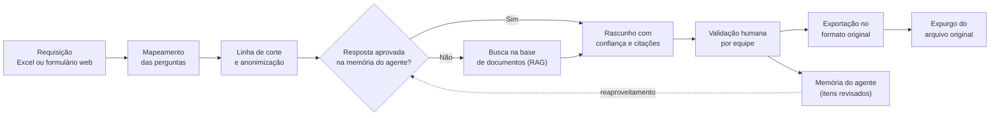
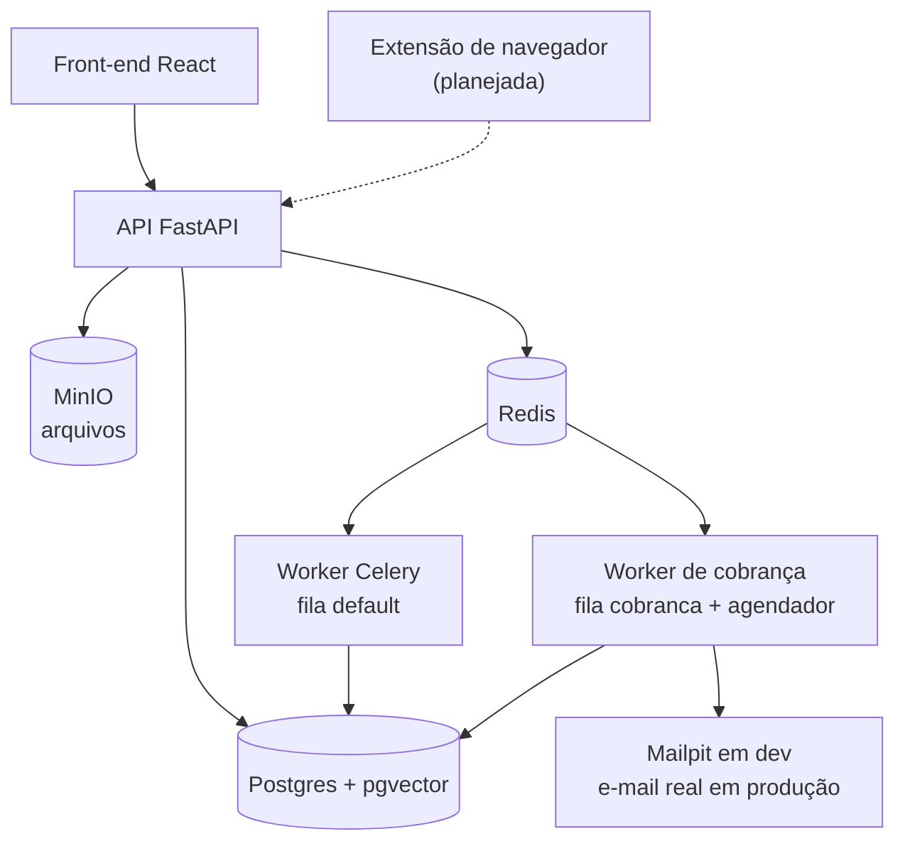

# RFP Automation

Automação do preenchimento de RFPs e RFIs com IA. A ferramenta responde questionários em Excel ou na web a partir de uma base de documentos (RAG) e de uma biblioteca de respostas aprovadas, distribui as validações às equipes, cobra os prazos e expurga o arquivo original quando a requisição é concluída.

> **Status: piloto em desenvolvimento (`v0.2.0-alpha`).** O esqueleto da aplicação e o login local estão prontos. As funções de negócio descritas abaixo fazem parte do plano e ainda não estão implementadas; veja [Estado atual](#estado-atual).

## Sumário

- [O problema](#o-problema)
- [Como o piloto vai funcionar](#como-o-piloto-vai-funcionar)
- [Estado atual](#estado-atual)
- [Arquitetura](#arquitetura)
- [Tecnologias](#tecnologias)
- [Como rodar](#como-rodar)
- [Comandos](#comandos)
- [Estrutura do repositório](#estrutura-do-repositório)
- [Segurança e privacidade](#segurança-e-privacidade)
- [Plano de ação](#plano-de-ação)
- [Como contribuir](#como-contribuir)

## O problema

Os questionários chegam por chamado, como arquivo Excel ou link de um formulário externo. Cada um exige localizar respostas em vários documentos, envolver várias equipes e acompanhar prazos manualmente, e as respostas já dadas raramente são reaproveitadas.

## Como o piloto vai funcionar



| Capacidade | O que faz |
| --- | --- |
| Excel fiel | Mapeia as perguntas e, na exportação, altera só as células de resposta, preservando formatação e estrutura. |
| Questionários web | Extensão de navegador (Chrome/Edge) que mapeia os campos do portal e preenche as respostas revisadas. |
| Base de conhecimento | Ingestão versionada de documentos, com validade e busca híbrida (vetorial + textual). |
| Anonimização na entrada | O analista escolhe a linha de corte por aba; dali para baixo o texto é anonimizado antes de chegar ao agente. |
| Agente próprio | Componente isolado que enxerga só seis campos anonimizados de cada requisição, além da base interna. |
| Memória do agente | Guarda somente itens revisados por humanos e anonimizados. Só respostas aprovadas são reaproveitadas. |
| Validação por equipe | Direciona cada pergunta à equipe responsável e cria tarefas com prazo interno. |
| Cobrança de prazos | Worker separado envia lembretes e escalonamentos por e-mail e Teams. |
| Chat por requisição | Conversa dentro da ferramenta, espelhada por e-mail. |
| Administração | Gestão de equipes, responsáveis, siglas de clientes e regras de escalonamento. |
| Expurgo | Remove o arquivo original ao concluir a requisição, mantendo só perguntas e respostas. |

## Estado atual

| Área | Situação |
| --- | --- |
| Estrutura de módulos, API, erros padronizados e logs JSON | Pronto |
| Banco com migrações, Celery, Docker Compose e CI | Pronto |
| Front-end base (React) com tela de login e rotas protegidas | Pronto |
| Login local para testes: usuários, papéis, sessões e bloqueio por tentativas | Pronto |
| SSO (OIDC), auditoria, cadastros e telas de administração | Próximo passo |
| Ingestão de documentos, busca, Excel, anonimização e geração de respostas | Planejado |
| Gateway de LLM com política de envio por configuração | Pronto |
| Provedores de LLM e embeddings | Só o adaptador `fake`, sem chamadas externas |
| Cobrança, chat, expurgo, extensão web e deploy | Planejado |

Os módulos além de `identidade` já têm pacote e rotas registradas, mas ainda não têm regras de negócio.

## Arquitetura

O piloto é um **monólito modular com portas e adaptadores**: um único deploy, simples de operar, com fronteiras prontas para crescer. Canais de entrada, provedores de IA, armazenamento e notificações ficam atrás de portas e podem ser trocados sem alterar o núcleo.



| Módulo | Responsabilidade |
| --- | --- |
| `identidade` | Usuários, papéis, login e permissões |
| `cadastros` | Clientes, siglas, equipes, membros e regras de escalonamento |
| `requisicoes` | Fluxo da requisição, estados, prazos e tarefas de validação |
| `questionarios` | Modelo canônico de perguntas e canais (Excel, web) |
| `conhecimento` | Ingestão, trechos, embeddings e busca híbrida |
| `biblioteca` | Respostas aprovadas e anonimizadas |
| `motor_respostas` | Geração (biblioteca, depois RAG), confiança e roteamento |
| `privacidade` | Anonimização, pseudonimização para o LLM, expurgo e retenção |
| `comunicacao` | Chat por requisição espelhado por e-mail |
| `cobranca` | Regras de escalonamento, lembretes e notificações |
| `auditoria` | Registro de quem fez o quê e quando |

### Regras de fronteira (verificadas no CI)

1. Um módulo só usa de outro o pacote raiz ou o `service.py` (`tests/test_arquitetura.py`).
2. Módulos não importam `app.adapters`; recebem as implementações pela raiz de composição (`lint-imports`).
3. `app.shared` não importa módulos nem adaptadores.
4. Adaptadores específicos de um módulo, como o leitor de Excel, ficam dentro do próprio módulo.

## Tecnologias

| Camada | Tecnologias |
| --- | --- |
| Backend | Python 3.12, FastAPI, Pydantic, SQLAlchemy 2, Alembic, structlog, argon2 |
| Tarefas assíncronas | Celery e Redis 7 |
| Dados | PostgreSQL 16 com pgvector e MinIO |
| Front-end | React 18, TypeScript, Vite, Tailwind CSS 4, TanStack Query |
| Desenvolvimento | Docker Compose, Mailpit, uv, pnpm |
| Qualidade | pytest, Vitest, ruff, mypy, import-linter, ESLint, Prettier, pre-commit, GitHub Actions |

## Como rodar

### Windows (PowerShell)

Pré-requisitos: Git e [Docker Desktop](https://www.docker.com/products/docker-desktop/). Python, Node e os bancos rodam nos containers.

```powershell
git clone <url-do-repositorio>
cd <pasta-do-repositorio>
.\dev.ps1 setup
```

O `setup` cria o `.env`, sobe os serviços, aplica as migrações e cria os usuários de teste. Nas próximas vezes, use `.\dev.ps1 up`.

Se o Windows bloquear o script, rode uma vez:

```powershell
Set-ExecutionPolicy -Scope CurrentUser RemoteSigned
```

### Linux, macOS ou WSL

Os mesmos comandos existem no `Makefile`: `make setup`, `make up`, `make test`.

### Sem Docker

Requer Python 3.12 com [uv](https://docs.astral.sh/uv/), Node 22 com pnpm, Postgres 16 com pgvector e Redis.

```powershell
cd backend
uv sync
uv run alembic upgrade head
uv run python -m app.seed
uv run uvicorn app.main:app --reload
# em outro terminal, dentro de backend:
uv run celery -A app.shared.celery_app worker -Q default,cobranca -l info --pool solo

# em outro terminal, na raiz do projeto:
cd frontend
pnpm install
pnpm dev
```

O `--pool solo` é necessário no Windows fora do Docker.

### Usuários de teste

O `setup` (ou `.\dev.ps1 seed`) cria um usuário por papel, todos com a senha local `rfp-local-123`.

| E-mail | Papel |
| --- | --- |
| `admin@rfp.local` | Administrador |
| `analista@rfp.local` | Analista |
| `validador@rfp.local` | Validador |
| `conhecimento@rfp.local` | Gestor de conhecimento |

Essas credenciais valem só para o ambiente local. Com `APP_ENV=producao`, a aplicação não inicia se `AUTH_LOCAL_ENABLED` estiver ligado. Após 5 senhas erradas seguidas, o usuário fica bloqueado por 15 minutos.

### Serviços locais

| Serviço | Endereço |
| --- | --- |
| Interface | http://localhost:5173 |
| API (OpenAPI) | http://localhost:8000/api/docs |
| Saúde das dependências | http://localhost:8000/api/v1/health/ready |
| Console do MinIO | http://localhost:9001 |
| E-mails capturados (Mailpit) | http://localhost:8025 |

## Comandos

No Windows, use `.\dev.ps1 <comando>`; nos demais sistemas, `make <comando>`.

| Comando | Função |
| --- | --- |
| `setup` | Primeira execução completa |
| `up` / `down` | Sobe ou derruba os serviços (os volumes são mantidos) |
| `logs` / `ps` | Acompanha os logs ou mostra o estado dos serviços |
| `migrate` | Aplica as migrações |
| `migration` | Cria uma migração |
| `seed` | Cria os usuários de teste |
| `test` | Testes do backend e do front-end |
| `test-integration` | Testes com Postgres, Redis e worker reais |
| `lint` / `fmt` | Verifica ou formata o código |
| `shell-api` | Abre um shell no container da API |

## Estrutura do repositório

```text
.
├── backend/
│   ├── app/
│   │   ├── main.py        # raiz de composição
│   │   ├── seed.py        # usuários de teste
│   │   ├── shared/        # configuração, banco, logs, erros, Celery, saúde
│   │   ├── modules/       # um pacote por módulo de negócio
│   │   └── adapters/      # LLM, embeddings, storage, e-mail, notificações, chamados
│   ├── migrations/        # Alembic
│   ├── prompts/           # prompts versionados
│   └── tests/
├── frontend/              # React + TypeScript + Vite + Tailwind
├── extension/             # extensão de navegador (planejada)
├── deploy/                # configuração do servidor do piloto (planejada)
├── .github/workflows/     # CI
├── docker-compose.yml
├── dev.ps1                # comandos no PowerShell
└── Makefile               # comandos no Linux, macOS e WSL
```

## Segurança e privacidade

RFPs trazem dados de clientes, então estas regras valem desde o início:

- O `.env` e arquivos de clientes não são versionados. Dados de teste são sintéticos.
- Texto de clientes (perguntas, respostas, arquivos e chat) nunca vai para os logs, apenas ids, contagens e códigos.
- Erros de validação não devolvem o valor recebido.
- O texto do questionário é anonimizado na entrada, com prévia confirmada pelo analista, antes de chegar ao agente.
- O agente não tem acesso a dados de clientes: de cada requisição, só recebe os seis campos descritos no [plano de ação](#plano-de-ação).
- Só itens revisados por humanos entram na memória do agente.
- O texto dos questionários é tratado como dado, nunca como instrução ao modelo, para reduzir o risco de prompt injection.
- O provedor de LLM precisa ter contrato que proíba o uso dos dados para treino.
- O que pode ser enviado ao provedor é definido pelas variáveis `LLM_*` do `.env` e pode ser restringido ou desligado sem mudança de código.

As credenciais do `.env.example` e do `docker-compose.yml` são exclusivas do ambiente local. Qualquer outro ambiente deve usar segredos próprios.

## Plano de ação

Plano revisado em 12/11/2026. São 16 sprints de uma semana; o sprint 2 é retomado em 16/11/2026 e, sem pausas, o piloto termina na semana de 22/02/2027. Itens marcados com **(novo)** entraram nesta revisão.

### O que mudou nesta revisão

- **Agente próprio.** O agente é um componente isolado dentro de `motor_respostas`, com prompt versionado e sem histórico de conversa. De cada requisição ele enxerga só seis campos, já anonimizados.
- **Anonimização na entrada.** A anonimização passa a acontecer antes da primeira geração de respostas, não só antes de salvar na biblioteca.
- **Linha de corte.** O analista escolhe, em cada aba, a linha a partir da qual o documento é extraído e anonimizado. O que fica acima (cabeçalho com dados do cliente) não é extraído nem chega ao agente.
- **Modelo por API.** O agente usa um modelo comercial por API, com a retenção padrão do provedor. Uma política de envio em configuração permite restringir ou desligar isso depois.

### O que o agente vê

| Campo | Origem | Tratamento antes de chegar ao agente |
| --- | --- | --- |
| Pergunta | Questionário, a partir da linha de corte | Anonimizada, com prévia confirmada pelo analista |
| Resposta do agente | O próprio agente | Já nasce sem dados de cliente; usa marcadores como `{{CLIENTE}}` |
| Resposta corrigida | Validador ou analista | Anonimizada ao salvar |
| Modelo de implantação | Requisição | Valor fechado: `on_premise` ou `hosting` |
| Comentários | Validador | Anonimizados ao salvar |
| Aprovação | Validador | Verdadeiro ou falso |

Nunca chegam ao agente: nome, sigla, CNPJ, domínios e contatos do cliente; o arquivo original e as linhas acima do corte; número do chamado e prazos; chat e e-mails; e a identidade de quem validou. Além desses campos, o agente lê apenas dados internos da empresa: a base de documentos e o escopo das equipes.

O isolamento é garantido em quatro camadas:

1. **Contrato.** `VisaoAgente` é o único tipo que `motor_respostas` aceita de uma requisição, e recusa campos extras.
2. **Banco.** A memória do agente fica no schema `agente`. O worker do agente usa um papel do Postgres sem permissão nos schemas de cadastros, requisições, comunicação e privacidade.
3. **Código.** O import-linter proíbe `motor_respostas` de importar `cadastros`, `requisicoes`, `comunicacao` e `privacidade`. Só `privacidade` escreve no schema `agente`.
4. **Teste de vazamento.** Nomes fictícios (canários) são plantados nas planilhas de teste. Se um deles aparecer em prompt, log ou schema `agente`, o CI falha.

### Controle de vieses

- O agente não sabe quem é o cliente, então não responde diferente por porte, setor ou histórico, nem leva contexto de um cliente para outro.
- O modelo de implantação é o único atributo do cliente que pode mudar uma resposta, e a memória é filtrada por ele.
- A memória só aceita itens revisados por uma pessoa. Resposta aprovada pode ser reaproveitada; resposta reprovada com correção serve só de exemplo.
- Dois testes entram no `make eval`: invariância (a mesma pergunta com clientes fictícios diferentes gera entrada idêntica para o agente) e sensibilidade (trocar on premise por hosting só muda a resposta nas perguntas marcadas como dependentes).

Isso elimina o viés ligado à identidade do cliente. Não elimina os vieses do modelo de base nem o do revisor que aprova sem ler; o primeiro é medido no conjunto de avaliação e o segundo, por auditoria de amostra no piloto.

### Anonimização e linha de corte

1. **Upload.** O arquivo original é cifrado no armazenamento. Nada é enviado ao agente.
2. **Sugestão.** O leitor propõe o mapeamento e sugere como linha de corte a primeira linha de pergunta de cada aba.
3. **Linha de corte.** O analista confirma ou move a linha, aba por aba.
4. **Detecção.** As linhas a partir do corte passam por cadastro do cliente, regex (CPF, CNPJ, e-mail, telefone, URL), Presidio com spaCy em português e uma lista de permissões para produtos da empresa e normas.
5. **Prévia.** O analista vê original e anonimizado lado a lado, marca o que escapou e desfaz máscaras indevidas. Termo marcado à mão vira apelido do cliente no cadastro.
6. **Confirmação.** O texto anonimizado vai para o schema `agente`. A tabela de correspondência (marcador para valor real) fica num cofre do módulo `privacidade`, cifrada com a chave da requisição.
7. **Exportação.** O módulo `privacidade` troca os marcadores pelos valores reais e escreve no arquivo original. O expurgo destrói arquivo, chave e tabela de correspondência.

A detecção automática não chega a 100% em texto livre. Por isso a prévia humana é obrigatória, e nenhum texto entra no schema `agente` sem confirmação. No piloto, a linha de corte vale para Excel; a extensão web usa um campo inicial equivalente.

### Modelo por API e política de envio

O provedor não hospeda a base de documentos, mas recebe em cada chamada os trechos que a busca recuperou para aquela pergunta, junto com a pergunta anonimizada. Para rever essa decisão sem refazer o agente, toda chamada passa por um gateway (`backend/app/shared/llm.py`) que aplica uma política lida do `.env`:

| Variável | Efeito |
| --- | --- |
| `LLM_ENABLED=false` | Desliga qualquer chamada ao modelo |
| `LLM_PROVIDER` e `LLM_MODEL` | Trocam o provedor e o modelo sem mexer no agente |
| `LLM_RETENCAO` | Declara o que o contrato garante: `padrao` ou `zero`. É uma declaração; o código não confere isso com o provedor |
| `LLM_EXIGE_RETENCAO_ZERO=true` | Recusa provedor externo sem retenção zero declarada |
| `LLM_ENVIA_TRECHOS_BASE=false` | Deixa de enviar trechos da base a provedor externo |
| `LLM_ENVIA_MEMORIA=false` | Deixa de enviar exemplos da memória a provedor externo |

Cada chamada gera um registro `llm_chamada` no log com provedor, modelo, retenção declarada, versão do prompt e tamanho de cada classe de dado enviada, sem o texto. O adaptador real (sprint 7) usa só chamadas síncronas e não guarda nada no provedor (sem API de lote, de arquivos ou de threads), para que uma eventual troca para retenção zero não exija mudança de código.

### Sprints

| Sprint | Semana de | Entrega | Situação |
| --- | --- | --- | --- |
| 1 | 26/10 | Esqueleto do projeto | Concluído (`v0.1.0`) |
| 2 | 16/11 | Cadastros e contratos | Em andamento (`v0.2.0-alpha`) |
| 3 | 23/11 | Ingestão de documentos | Planejado |
| 4 | 30/11 | Busca híbrida e leitura do Excel | Planejado |
| 5 | 07/12 | Escrita fiel no Excel (**portão 1**) | Planejado |
| 6 | 14/12 | Anonimização e linha de corte (**portão de privacidade**) | Planejado |
| 7 | 21/12 | Requisições e primeira geração | Planejado |
| 8 | 28/12 | Roteamento e revisão | Planejado |
| 9 | 04/01 | Memória do agente e avaliação (**portão 2**) | Planejado |
| 10 a 12 | 11/01 a 25/01 | Cobrança, chat, e-mails recebidos e expurgo | Planejado |
| 13 e 14 | 01/02 e 08/02 | Extensão de navegador (**portão 3**) | Planejado |
| 15 | 15/02 | Deploy, SSO e piloto assistido | Planejado |
| 16 | 22/02 | Medição e decisão sobre produção (**portão 4**) | Planejado |

#### Sprint 2 — Cadastros e contratos

- [x] Login local para testes, com papéis, sessões e bloqueio por tentativas
- [x] **(novo)** Gateway de LLM com política de envio por configuração
- [ ] Módulo de auditoria e registro automático das ações de admin
- [ ] Cadastros e telas de admin: clientes (sigla, nomes, CNPJ, domínios, apelidos), equipes com escopo, membros e regras de escalonamento
- [ ] **(novo)** Modelo de implantação padrão no cadastro do cliente
- [ ] Contratos: portas, modelo canônico, eventos, outbox e adaptadores falsos
- [ ] **(novo)** Contrato `VisaoAgente` e porta `Anonymizer` revisada, com linha inicial e marcadores tipados
- [ ] **(novo)** Schema `agente`, papel do Postgres sem acesso aos demais schemas e regra no import-linter
- [ ] Pedir ao TI o registro do aplicativo para o SSO (a integração fica para o sprint 15)

**Pronto quando:** o admin cadastra 3 equipes e 2 clientes com as ações na auditoria, e um teste prova que o papel do agente não lê nenhuma tabela de cliente.

#### Sprint 3 — Ingestão de documentos

- [ ] Armazenamento cifrado por arquivo no MinIO
- [ ] Upload de documento com título, equipe dona, versão e validade
- [ ] Ingestão com Docling, divisão em trechos, metadados e hash para detectar mudança
- [ ] Embeddings locais no pgvector e coluna de busca textual em português
- [ ] Nova versão marca a anterior como obsoleta

**Pronto quando:** 20 documentos reais da empresa estão indexados, e um documento alterado é reindexado sozinho.

#### Sprint 4 — Busca e leitura do Excel

- [ ] Busca híbrida com reranker, filtros e tela de teste para o gestor de conhecimento
- [ ] Leitor de Excel: abas, cabeçalho, colunas de pergunta e resposta, validações de dados e células mescladas
- [ ] **(novo)** O leitor guarda o número da linha de cada pergunta e sugere a linha de corte por aba
- [ ] Removido: sugestão de layout pelo LLM. Quando as heurísticas falharem, o analista mapeia à mão

**Pronto quando:** a busca devolve os trechos certos em menos de 2 segundos, e o leitor propõe mapeamento e linha de corte corretos em pelo menos 8 de 10 planilhas de referência.

#### Sprint 5 — Escrita fiel no Excel

- [ ] Tela para confirmar ou corrigir o mapeamento
- [ ] **(novo)** Controle de linha de corte por aba na mesma tela
- [ ] Escritor no XML com lxml, exportação em memória e testes de fidelidade

**Pronto quando:** as 10 a 20 planilhas de referência passam no teste de fidelidade. **Portão 1.**

#### Sprint 6 — Anonimização (novo)

- [ ] Detector em quatro etapas: cadastro, regex, Presidio com spaCy `pt_core_news_lg` e lista de permissões
- [ ] Marcadores tipados e consistentes por requisição
- [ ] Prévia lado a lado com destaques e correção manual
- [ ] Cofre de correspondência cifrado e troca dos marcadores na exportação
- [ ] Planilhas de referência com clientes fictícios e canários plantados
- [ ] Teste de vazamento no CI

**Pronto quando:** nenhum canário chega ao schema `agente` nas planilhas de referência, e a planilha exportada volta com os valores reais nos lugares certos. **Portão de privacidade.**

#### Sprint 7 — Requisições e primeira geração

- [ ] Abertura de requisição com tipo, sigla, prazo, chamado e upload; estados e prazo interno em dias úteis
- [ ] **(novo)** Modelo de implantação obrigatório na abertura
- [ ] **(novo)** Agente: prompt versionado em `backend/prompts/`, entrada montada só com `VisaoAgente` e trechos da base
- [ ] Saída estruturada: resposta, confiança, citações e "não encontrado"; respeito a opções válidas e limite de caracteres
- [ ] **(novo)** Escolha do provedor: as mesmas 30 perguntas em dois ou três modelos por API; decisão registrada em um ADR
- [ ] **(novo)** Adaptador real só com chamadas síncronas, declarado como externo para a política valer
- [ ] Geração em lote no nosso worker, com chamadas em paralelo e progresso na tela

**Pronto quando:** uma planilha real é respondida em lote, com citações, em até 20 minutos para 300 perguntas, e o registro das chamadas mostra só campos do contrato.

#### Sprint 8 — Roteamento e revisão

- [ ] Roteamento por três sinais (histórico, dono do documento citado e classificação pelo agente), fila de triagem e tarefas por equipe
- [ ] Tela de revisão: filtros, edição, aprovação ou reprovação, fontes ao lado e histórico
- [ ] **(novo)** Campo de comentário por resposta
- [ ] **(novo)** Anonimização da resposta corrigida e do comentário ao salvar
- [ ] Conjunto de avaliação com cerca de 100 perguntas, resposta de referência e equipe correta
- [ ] **(novo)** Marcar no conjunto quais perguntas dependem do modelo de implantação

**Pronto quando:** um validador vê só as perguntas da sua equipe, aprova ou corrige cada uma com comentário, e o que é salvo já está anonimizado.

#### Sprint 9 — Memória do agente e avaliação

- [ ] **(novo)** Memória com os seis campos no schema `agente`; só itens revisados entram
- [ ] **(novo)** Reaproveitamento apenas de respostas aprovadas, filtrado por modelo de implantação
- [ ] Busca por pergunta parecida, validade e marcação para revisão quando um documento muda
- [ ] `make eval`: precisão, citação correta, "não encontrado" correto e acerto de equipe
- [ ] **(novo)** Testes de invariância e de sensibilidade no `make eval`
- [ ] **(novo, opcional)** Carga de RFPs antigos já respondidos pela mesma tela de corte e anonimização

**Pronto quando:** as metas de qualidade são atingidas no conjunto de avaliação e os dois testes de viés passam. **Portão 2.**

#### Sprints 10 a 12 — Cobrança, chat, e-mails e expurgo

- [ ] Worker de cobrança com regras de escalonamento, notificadores e resumo diário por pessoa
- [ ] Chat por requisição, espelhado por e-mail, com leitura das respostas recebidas
- [ ] Expurgo do arquivo original, da chave e das mensagens, com conciliação diária
- [ ] **(novo)** O expurgo destrói também o cofre de correspondência da requisição
- [ ] **(novo)** Teste de que mensagens do chat e e-mails não chegam ao schema `agente`

**Pronto quando:** as cobranças disparam uma vez para as pessoas certas, uma resposta por e-mail aparece limpa no chat, e uma requisição concluída não deixa arquivo, chave, mensagens nem correspondência para trás.

#### Sprints 13 e 14 — Extensão web

- [ ] Extensão Manifest V3 que mapeia os campos do formulário e preenche as respostas revisadas
- [ ] **(novo)** O analista marca o campo inicial, e os rótulos passam pelo detector antes de chegar ao agente

**Pronto quando:** um questionário real é mapeado, anonimizado, respondido, validado e preenchido pela extensão. **Portão 3.**

#### Sprint 15 — Piloto assistido

- [ ] Deploy no servidor do piloto com HTTPS, backups e monitoramento de erros
- [ ] Login SSO (OIDC); login local desligado em produção
- [ ] Apresentação para analistas e validadores, incluindo a prévia de anonimização
- [ ] Primeiras requisições reais acompanhadas de perto

**Pronto quando:** pelo menos 3 requisições reais estão em andamento na ferramenta.

#### Sprint 16 — Medição e decisão

- [ ] Coleta das métricas do piloto
- [ ] Auditoria de 10% da memória do agente em busca de dados de clientes
- [ ] **(novo)** Auditoria de uma amostra de aprovações
- [ ] Relatório do piloto e lista priorizada para a produção

**Pronto quando:** o relatório está apresentado e a decisão sobre produção foi tomada. **Portão 4.**

### Portões de qualidade

Os portões são critérios de qualidade: a etapa seguinte só começa depois que o anterior é atendido.

| Portão | Sprint | Critério para avançar |
| --- | --- | --- |
| 1 · Fidelidade do Excel | 5 | As planilhas de referência passam na comparação byte a byte das partes não mapeadas e abrem sem erro |
| Privacidade | 6 | Zero canários em prompts, logs e schema `agente`; todos os identificadores do cadastro mascarados nas planilhas de referência |
| 2 · Qualidade e viés | 9 | Metas de qualidade atingidas; invariância em 100% dos casos; sensibilidade restrita às perguntas marcadas |
| 3 · Fluxo web | 14 | Um questionário real percorre o fluxo inteiro pela extensão |
| 4 · Decisão | 16 | Relatório apresentado e decisão sobre produção tomada |

### Riscos

| Risco | Tratamento |
| --- | --- |
| Um identificador que o detector não conhece escapa | Prévia humana obrigatória, apelidos aprendidos a cada correção e auditoria por amostra |
| A pergunta descreve o cliente sem citá-lo | Só uma pessoa percebe; o analista reescreve o trecho na prévia. Risco residual aceito |
| Máscara em excesso apaga nomes de produtos e normas | Lista de permissões e métrica de máscaras desfeitas |
| A empresa passa a proibir API com retenção padrão ou o envio de trechos da base | A política muda por configuração: exigir retenção zero, reter os trechos da base ou desligar o LLM |
| O revisor aprova o rascunho sem ler | Auditoria de amostra no sprint 16 e marcação para revisão quando o documento de origem muda |
| Um desenvolvedor só para 15 semanas de trabalho | Cortar escopo de fora para dentro (extensão, Teams, respostas por e-mail). Isolamento do agente e anonimização não se cortam |

### Pontos em aberto

- [ ] Confirmar que o agente pode ler a base interna de documentos (premissa adotada: sim, porque não tem dados de clientes)
- [ ] Confirmar a direção da linha de corte (premissa adotada: anonimiza da linha escolhida para baixo; o que fica acima não é extraído)

## Como contribuir

- Crie branches curtas a partir de `main` com os prefixos `feat/`, `fix/` ou `chore/`.
- Use [Conventional Commits](https://www.conventionalcommits.org/pt-br/) e abra um PR por tarefa.
- Crie uma tag ao fim de cada sprint (`v0.1.0` = sprint 1).
- Rode `pre-commit install` para verificar o código antes de cada commit.
- Mudanças em prompts só entram se a avaliação da IA não piorar as métricas.
