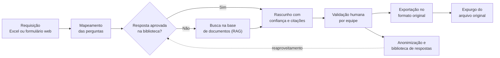
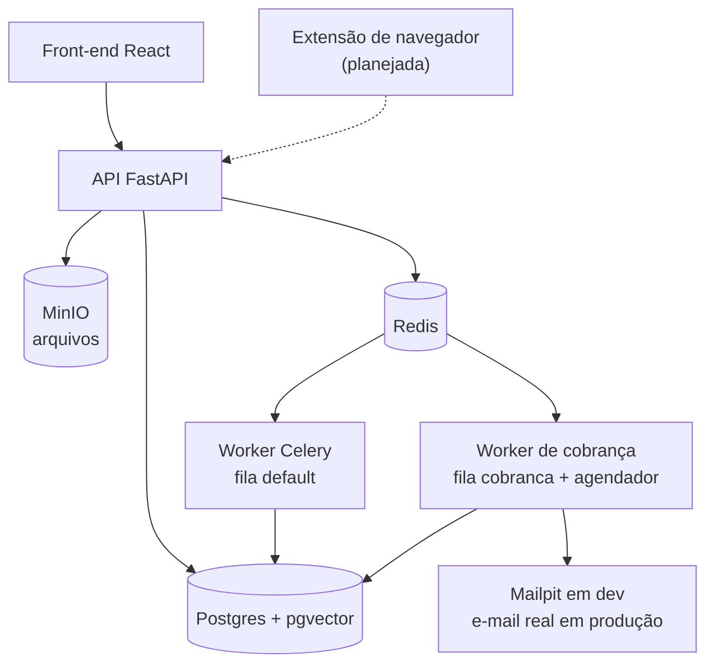

# RFP Automation

Automação do preenchimento de RFPs e RFIs com IA. A ferramenta responde questionários em Excel ou na web a partir de uma base de documentos (RAG) e de uma biblioteca de respostas aprovadas, distribui as validações às equipes, cobra os prazos e expurga o arquivo original quando a requisição é concluída.

> **Status: piloto em desenvolvimento (`v0.2.0-alpha`).** O esqueleto da aplicação e o login local estão prontos. As funções de negócio descritas abaixo fazem parte do plano e ainda não estão implementadas; veja [Estado atual](#estado-atual).

## Sumário

- [O problema](#o-problema)
- [Como o piloto vai funcionar](#como-o-piloto-vai-funcionar)
- [Estado atual](#estado-atual)
- [Arquitetura](#arquitetura)
- [Tecnologias](#tecnologias)
- [Como rodar](#como-rodar)
- [Comandos](#comandos)
- [Estrutura do repositório](#estrutura-do-repositório)
- [Segurança e privacidade](#segurança-e-privacidade)
- [Roadmap](#roadmap)
- [Como contribuir](#como-contribuir)

## O problema

Os questionários chegam por chamado, como arquivo Excel ou link de um formulário externo. Cada um exige localizar respostas em vários documentos, envolver várias equipes e acompanhar prazos manualmente, e as respostas já dadas raramente são reaproveitadas.

## Como o piloto vai funcionar



| Capacidade | O que faz |
| --- | --- |
| Excel fiel | Mapeia as perguntas e, na exportação, altera só as células de resposta, preservando formatação e estrutura. |
| Questionários web | Extensão de navegador (Chrome/Edge) que mapeia os campos do portal e preenche as respostas revisadas. |
| Base de conhecimento | Ingestão versionada de documentos, com validade e busca híbrida (vetorial + textual). |
| Biblioteca de respostas | Guarda somente respostas aprovadas por humanos e anonimizadas. Só cresce com validação. |
| Validação por equipe | Direciona cada pergunta à equipe responsável e cria tarefas com prazo interno. |
| Cobrança de prazos | Worker separado envia lembretes e escalonamentos por e-mail e Teams. |
| Chat por requisição | Conversa dentro da ferramenta, espelhada por e-mail. |
| Administração | Gestão de equipes, responsáveis, siglas de clientes e regras de escalonamento. |
| Expurgo | Remove o arquivo original ao concluir a requisição, mantendo só perguntas e respostas. |

## Estado atual

| Área | Situação |
| --- | --- |
| Estrutura de módulos, API, erros padronizados e logs JSON | Pronto |
| Banco com migrações, Celery, Docker Compose e CI | Pronto |
| Front-end base (React) com tela de login e rotas protegidas | Pronto |
| Login local para testes: usuários, papéis, sessões e bloqueio por tentativas | Pronto |
| SSO (OIDC), auditoria, cadastros e telas de administração | Próximo passo |
| Ingestão de documentos, busca, Excel e geração de respostas | Planejado |
| Provedores de LLM e embeddings | Só o adaptador `fake`, sem chamadas externas |
| Cobrança, chat, expurgo, extensão web e deploy | Planejado |

Os módulos além de `identidade` já têm pacote e rotas registradas, mas ainda não têm regras de negócio.

## Arquitetura

O piloto é um **monólito modular com portas e adaptadores**: um único deploy, simples de operar, com fronteiras prontas para crescer. Canais de entrada, provedores de IA, armazenamento e notificações ficam atrás de portas e podem ser trocados sem alterar o núcleo.



| Módulo | Responsabilidade |
| --- | --- |
| `identidade` | Usuários, papéis, login e permissões |
| `cadastros` | Clientes, siglas, equipes, membros e regras de escalonamento |
| `requisicoes` | Fluxo da requisição, estados, prazos e tarefas de validação |
| `questionarios` | Modelo canônico de perguntas e canais (Excel, web) |
| `conhecimento` | Ingestão, trechos, embeddings e busca híbrida |
| `biblioteca` | Respostas aprovadas e anonimizadas |
| `motor_respostas` | Geração (biblioteca, depois RAG), confiança e roteamento |
| `privacidade` | Anonimização, pseudonimização para o LLM, expurgo e retenção |
| `comunicacao` | Chat por requisição espelhado por e-mail |
| `cobranca` | Regras de escalonamento, lembretes e notificações |
| `auditoria` | Registro de quem fez o quê e quando |

### Regras de fronteira (verificadas no CI)

1. Um módulo só usa de outro o pacote raiz ou o `service.py` (`tests/test_arquitetura.py`).
2. Módulos não importam `app.adapters`; recebem as implementações pela raiz de composição (`lint-imports`).
3. `app.shared` não importa módulos nem adaptadores.
4. Adaptadores específicos de um módulo, como o leitor de Excel, ficam dentro do próprio módulo.

## Tecnologias

| Camada | Tecnologias |
| --- | --- |
| Backend | Python 3.12, FastAPI, Pydantic, SQLAlchemy 2, Alembic, structlog, argon2 |
| Tarefas assíncronas | Celery e Redis 7 |
| Dados | PostgreSQL 16 com pgvector e MinIO |
| Front-end | React 18, TypeScript, Vite, Tailwind CSS 4, TanStack Query |
| Desenvolvimento | Docker Compose, Mailpit, uv, pnpm |
| Qualidade | pytest, Vitest, ruff, mypy, import-linter, ESLint, Prettier, pre-commit, GitHub Actions |

## Como rodar

### Windows (PowerShell)

Pré-requisitos: Git e [Docker Desktop](https://www.docker.com/products/docker-desktop/). Python, Node e os bancos rodam nos containers.

```powershell
git clone <url-do-repositorio>
cd <pasta-do-repositorio>
.\dev.ps1 setup
```

O `setup` cria o `.env`, sobe os serviços, aplica as migrações e cria os usuários de teste. Nas próximas vezes, use `.\dev.ps1 up`.

Se o Windows bloquear o script, rode uma vez:

```powershell
Set-ExecutionPolicy -Scope CurrentUser RemoteSigned
```

### Linux, macOS ou WSL

Os mesmos comandos existem no `Makefile`: `make setup`, `make up`, `make test`.

### Sem Docker

Requer Python 3.12 com [uv](https://docs.astral.sh/uv/), Node 22 com pnpm, Postgres 16 com pgvector e Redis.

```powershell
cd backend
uv sync
uv run alembic upgrade head
uv run python -m app.seed
uv run uvicorn app.main:app --reload
# em outro terminal, dentro de backend:
uv run celery -A app.shared.celery_app worker -Q default,cobranca -l info --pool solo

# em outro terminal, na raiz do projeto:
cd frontend
pnpm install
pnpm dev
```

O `--pool solo` é necessário no Windows fora do Docker.

### Usuários de teste

O `setup` (ou `.\dev.ps1 seed`) cria um usuário por papel, todos com a senha local `rfp-local-123`.

| E-mail | Papel |
| --- | --- |
| `admin@rfp.local` | Administrador |
| `analista@rfp.local` | Analista |
| `validador@rfp.local` | Validador |
| `conhecimento@rfp.local` | Gestor de conhecimento |

Essas credenciais valem só para o ambiente local. Com `APP_ENV=producao`, a aplicação não inicia se `AUTH_LOCAL_ENABLED` estiver ligado. Após 5 senhas erradas seguidas, o usuário fica bloqueado por 15 minutos.

### Serviços locais

| Serviço | Endereço |
| --- | --- |
| Interface | http://localhost:5173 |
| API (OpenAPI) | http://localhost:8000/api/docs |
| Saúde das dependências | http://localhost:8000/api/v1/health/ready |
| Console do MinIO | http://localhost:9001 |
| E-mails capturados (Mailpit) | http://localhost:8025 |

## Comandos

No Windows, use `.\dev.ps1 <comando>`; nos demais sistemas, `make <comando>`.

| Comando | Função |
| --- | --- |
| `setup` | Primeira execução completa |
| `up` / `down` | Sobe ou derruba os serviços (os volumes são mantidos) |
| `logs` / `ps` | Acompanha os logs ou mostra o estado dos serviços |
| `migrate` | Aplica as migrações |
| `migration` | Cria uma migração |
| `seed` | Cria os usuários de teste |
| `test` | Testes do backend e do front-end |
| `test-integration` | Testes com Postgres, Redis e worker reais |
| `lint` / `fmt` | Verifica ou formata o código |
| `shell-api` | Abre um shell no container da API |

## Estrutura do repositório

```text
.
├── backend/
│   ├── app/
│   │   ├── main.py        # raiz de composição
│   │   ├── seed.py        # usuários de teste
│   │   ├── shared/        # configuração, banco, logs, erros, Celery, saúde
│   │   ├── modules/       # um pacote por módulo de negócio
│   │   └── adapters/      # LLM, embeddings, storage, e-mail, notificações, chamados
│   ├── migrations/        # Alembic
│   ├── prompts/           # prompts versionados
│   └── tests/
├── frontend/              # React + TypeScript + Vite + Tailwind
├── extension/             # extensão de navegador (planejada)
├── deploy/                # configuração do servidor do piloto (planejada)
├── .github/workflows/     # CI
├── docker-compose.yml
├── dev.ps1                # comandos no PowerShell
└── Makefile               # comandos no Linux, macOS e WSL
```

## Segurança e privacidade

RFPs trazem dados de clientes, então estas regras valem desde o início:

- O `.env` e arquivos de clientes não são versionados. Dados de teste são sintéticos.
- Texto de clientes (perguntas, respostas, arquivos e chat) nunca vai para os logs, apenas ids, contagens e códigos.
- Erros de validação não devolvem o valor recebido.
- Toda resposta passa por validação humana e anonimização antes de entrar na biblioteca.
- O texto dos questionários é tratado como dado, nunca como instrução ao modelo, para reduzir o risco de prompt injection.
- O provedor de LLM precisa ter contrato que proíba o uso dos dados para treino.

As credenciais do `.env.example` e do `docker-compose.yml` são exclusivas do ambiente local. Qualquer outro ambiente deve usar segredos próprios.

## Roadmap

| Sprint | Entrega | Situação |
| --- | --- | --- |
| 1 | Esqueleto do projeto | Concluído (`v0.1.0`) |
| 2 | Identidade, cadastros e contratos | Em andamento (`v0.2.0-alpha`) |
| 3 | Ingestão de documentos | Planejado |
| 4 | Busca híbrida e leitura do Excel | Planejado |
| 5 | Escrita fiel no Excel (**portão 1**) | Planejado |
| 6 a 8 | Geração de respostas, validação, privacidade e avaliação da IA (**portão 2**) | Planejado |
| 9 | Cobrança de prazos | Planejado |
| 10 | Chat por requisição | Planejado |
| 11 | E-mails recebidos e expurgo | Planejado |
| 12 e 13 | Extensão de navegador (**portão 3**) | Planejado |
| 14 | Deploy e piloto assistido | Planejado |
| 15 | Medição e decisão sobre produção (**portão 4**) | Planejado |

Os portões são critérios de qualidade: a etapa seguinte só começa depois que o anterior é atendido.

## Como contribuir

- Crie branches curtas a partir de `main` com os prefixos `feat/`, `fix/` ou `chore/`.
- Use [Conventional Commits](https://www.conventionalcommits.org/pt-br/) e abra um PR por tarefa.
- Crie uma tag ao fim de cada sprint (`v0.1.0` = sprint 1).
- Rode `pre-commit install` para verificar o código antes de cada commit.
- Mudanças em prompts só entram se a avaliação da IA não piorar as métricas.
